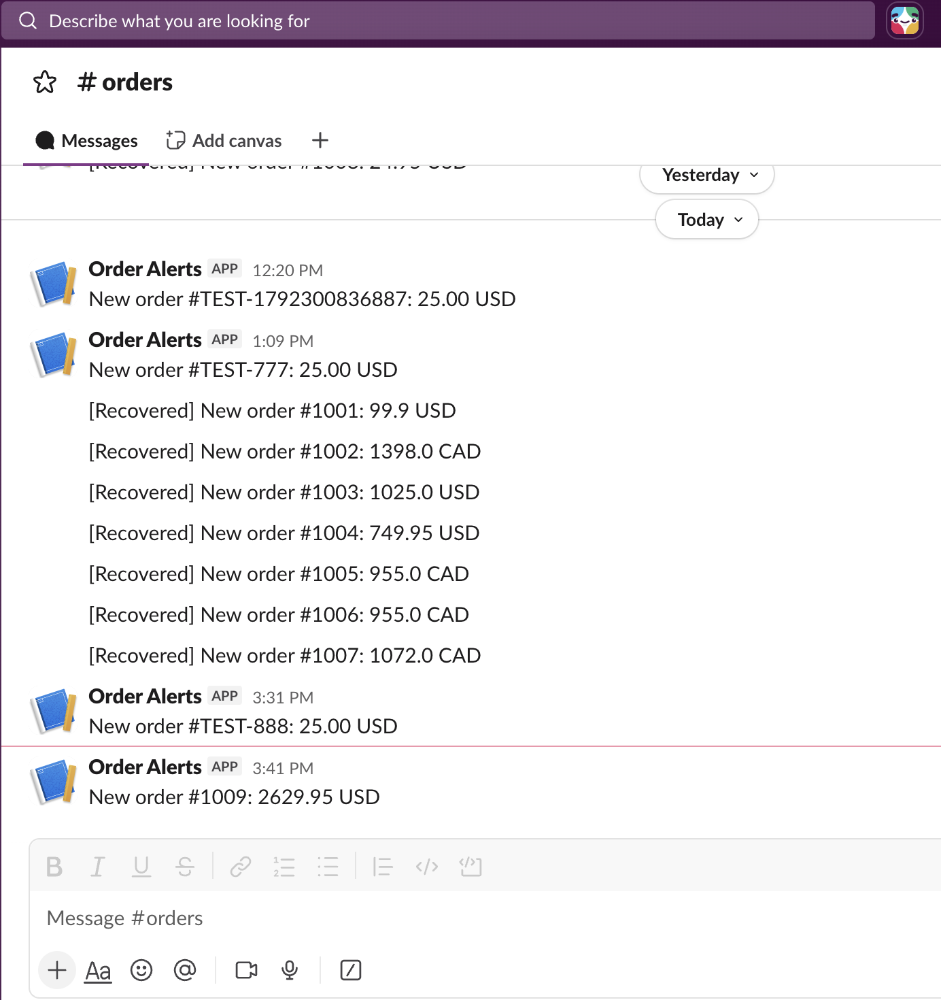

# Order Alerts

A small Node.js app that posts a Slack message for every new Shopify order and
recovers alerts that were missed. Built against a Shopify development store as
a portfolio project.



## The problem

A small team doesn't want to keep the Shopify admin open all day to notice new
orders. Webhooks can do this, but a basic receiver breaks in three ways: it
trusts forged requests, it alerts twice when Shopify re-delivers, and it
silently loses an alert if it is down or Slack fails. This project handles all
three.

## How it works

```
Shopify (orders/create webhook)
   -> POST https://<service>.onrender.com/webhooks    (Render web service)
   -> verify HMAC signature   (reject forged requests with 401)
   -> reply 200 immediately
   -> skip if this order ID is already in Postgres
   -> send Slack alert
   -> record the order ID in Postgres (Supabase)

Reconciliation script (run manually)
   -> fetch recent orders through the Admin GraphQL API (paginated)
   -> alert any order not yet recorded
```

## Design decisions

- **Verify before anything else.** The signature is computed over the raw
  request body with the app's client secret and compared with
  `timingSafeEqual`. The body is parsed only after it passes, so forged data
  never gets parsed.
- **Reply first, work second.** Shopify allows a one-second connection timeout
  and about five seconds for a response, so the handler answers 200 and sends
  the Slack alert afterwards. Trade-off: if Slack fails after the reply,
  Shopify won't retry. That is what the reconciliation script is for.
- **Dedupe by order ID, not webhook ID.** The webhook handler and the
  reconciliation script both need to answer "did we alert for this order?",
  and only the order ID is available to both. It is the primary key of the
  `alerted_orders` table.
- **Alert first, record afterwards.** A failed Slack call leaves the order
  unrecorded, so reconciliation can recover it. Recording first would lose it.
- **Minimal data in Slack and logs.** Messages contain only the order number,
  total and currency. No customer details.
- **Slack incoming webhook instead of a bot token.** It needs no scopes or
  token handling for a single channel. A bot token would be the next step if
  alerts had to be routed to different channels.
- **Alert sending is isolated** in `src/slack.js`, so Teams or email could
  replace it by changing one file.
- **Why Render and Supabase.** Both have free tiers. Render runs an
  always-listening Express server exactly as written, and the database is
  separate from the host, so either can be replaced on its own. The app uses
  plain SQL through `pg`, so any Postgres host would work by changing one
  connection string.
- **Configuration in one place.** `src/config.js` loads `.env`, checks that
  every required variable is set, and fails at startup with a clear message
  if one is missing.

## Project structure

```
src/
  config.js    environment variables, validated at startup
  shopify.js   token handling and the GraphQL helper
  slack.js     sendAlert(text)
  db.js        shared Postgres connection pool
  store.js     hasAlerted / markAlerted (Postgres)
  server.js    Express webhook receiver
  index.js     example orders query
scripts/
  create-webhook.js      subscribe to orders/create
  list-webhooks.js       list subscriptions
  delete-webhook.js      delete a subscription
  reconcile.js           find and alert orders missing an alert
  send-test-webhook.js   send a signed fake order
  db-check.js            check the database connection
```

## Setup

1. **Create the Shopify app.** In the Dev Dashboard, create an app with the
   `read_orders` scope and webhooks API version `2026-10`, then install it on
   your store. Reading the Order object requires protected customer data
   access. For this app, selecting **custom distribution** (a single store)
   resolved the "not approved to access the Order object" error.
2. **Create a Supabase project** and run:

   ```sql
   create table alerted_orders (
     order_id text primary key,
     alerted_at timestamptz not null default now()
   );
   alter table alerted_orders enable row level security;
   ```

3. **Create a Slack incoming webhook** for the channel that should receive
   alerts.
4. **Create `.env`** (never commit it):

   ```
   SHOPIFY_SHOP=your-store-subdomain
   SHOPIFY_CLIENT_ID=
   SHOPIFY_CLIENT_SECRET=
   SLACK_WEBHOOK_URL=
   DATABASE_URL=
   ```

   `SHOPIFY_SHOP` is the subdomain only, without `.myshopify.com`.
   `DATABASE_URL` is Supabase's session pooler connection string, which works
   on networks without IPv6.
5. **Run it locally:** `npm install`, then `npm start`.
6. **Deploy to Render** as a web service: build command `npm install`, start
   command `npm start`, instance type Free, and the same five environment
   variables. Do not set `PORT`; Render provides it.
7. **Subscribe to orders** once the service has a public address:

   ```
   node scripts/create-webhook.js https://<your-host>
   ```

   Pass the base address only. The script adds `/webhooks` itself.

## Scripts

```
node scripts/send-test-webhook.js [orderId]    signed fake order; set WEBHOOK_URL to target a deployed server
node scripts/reconcile.js 24 [--send]          list (or alert) orders from the last 24 hours with no alert
node scripts/list-webhooks.js                  list webhook subscriptions
node scripts/delete-webhook.js <id>            delete a subscription
node scripts/db-check.js                       check the database connection
```

`reconcile.js` is a dry run unless `--send` is passed.

Example of testing a deployed server:

```
WEBHOOK_URL=https://<your-host>/webhooks node scripts/send-test-webhook.js 888
```

## Known limits

- **Free-tier hosting sleeps.** Render's free web service spins down after 15
  minutes without traffic. Shopify only waits one second to connect, so the
  first delivery after an idle period can fail. Shopify retries failed
  deliveries (8 times over 4 hours), and the reconciliation script catches
  anything that still slips through.
- **The free database pauses after a week of inactivity.** Supabase pauses
  idle free projects, and a paused database must be restored from the
  dashboard. While it is paused, the handler cannot check for duplicates.
- **Reply-before-alert trade-off.** The handler answers 200 before sending the
  Slack alert, so a Slack failure after the reply is not retried by Shopify.
  Reconciliation recovers it.
- **Reconciliation is manual.** It is not scheduled. A cron job, or a run on
  server startup, would automate it.
- **Possible double alert.** Two deliveries for the same order arriving at the
  same instant could both pass the duplicate check and send two alerts. A
  database-side claim on the order ID would close this.
- **Order search timestamps must be wrapped in single quotes.** In testing,
  an unquoted timestamp silently ignored the time and returned every order
  from that day.
- **Token handling is adapted from Shopify's client credentials example.** The
  token expires after 24 hours and is refreshed with a 60 second safety
  margin. The client credentials grant is meant for apps in the same
  organization as the store; an app installed on other merchants' stores
  would use a different flow.

## What I'd do next

- Run reconciliation on a schedule instead of by hand.
- Put alerts on a queue handled by a worker, so a Slack outage never loses an
  alert between the reply and the send.
- Move to a bot token and route alerts to different channels (for example,
  wholesale orders to their own channel).
- Add the `inventory_levels/update` topic for low-stock alerts.

## Status

Deployed on Render (free tier) with a Supabase Postgres database, connected to
a development store. Not intended for production use as it stands; see
"Known limits."